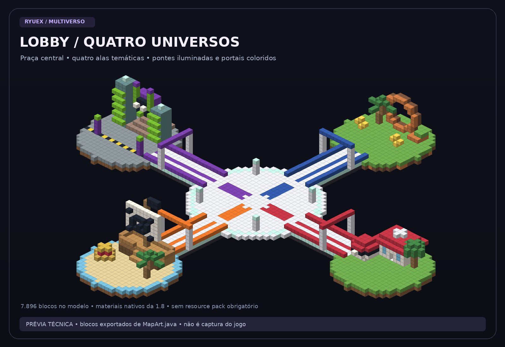
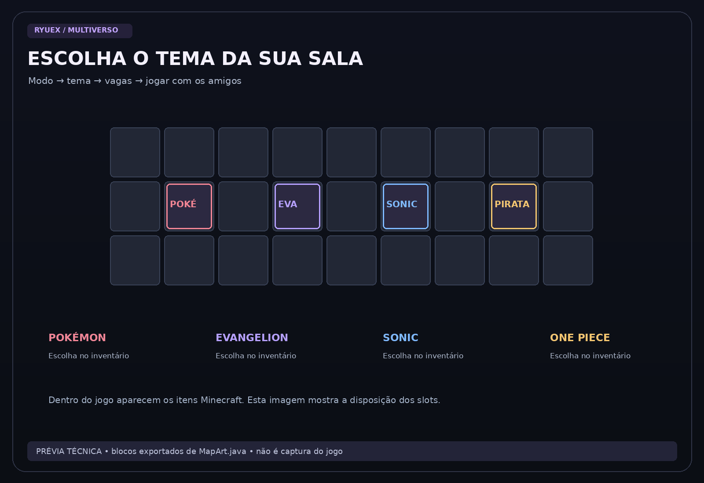

# Ryuex Treino • Minecraft Java 1.8.9

BedWars, BedFight e SkyWars para jogar com seus amigos. **Ilhas inspiradas em Pokémon, Evangelion, Sonic e One Piece**, com lobby misturando os quatro universos. Plugin próprio, seleção de tema/vagas e construções geradas automaticamente.

[](https://github.com/silasquercloud/ServeeDetreino/actions)

**[Party](docs/PARTY.md) · [Menu de instalação](docs/MENU.md) · [Guia completo](docs/GUIA.md) · [Configurar Playit](docs/PLAYIT.md) · [Ver imagens](docs/GALERIA.md) · [Criar Codespace](https://codespaces.new/silasquercloud/ServeeDetreino)**



> As imagens são projeções técnicas do mapa e do menu implementados, não screenshots de uma partida. [Galeria e limites das prévias →](docs/GALERIA.md)

## Comece pelo menu

No Linux ou no terminal do Codespace:

```bash
bash menu.sh
```

| Opção | Ação |
| --- | --- |
| **1 — Configurar Playit** | Baixa os binários oficiais, vincula o agente à sua conta e cadastra o endereço/porta do túnel. |
| **2 — Instalar servidor completo** | Compila Spigot 1.8.8 e TreinoHub, inclui mapas/lobby/salas e prepara `server.properties`. |
| **3 — Ligar servidor e mostrar IP/porta** | Inicia Playit + Minecraft, exibe os dados para conectar e abre o console. |
| **4 — Ver endereço salvo** | Consulta os dados sem iniciar o servidor. |
| **5 — Atualizar servidor** | Busca as alterações do GitHub, compila/testa e atualiza o plugin com backup, preservando seus dados. |
| **0 — Sair** | Fecha o menu. |

Antes de abrir o menu, o próprio script verifica e instala o que faltar: **Python 3, Git, curl, certificados, utilitários, JDK 17, JDK 8 e os dois binários oficiais do Playit**. Isso também corrige um Codespace existente com `python3: not found`; não é necessário recriar o ambiente. O bootstrap não instala nem inicia o servidor antes das opções abaixo.

O alvo principal é Ubuntu 24.04/Debian no Codespace. Os pacotes de sistema usam `apt-get` (ou `pacman` no Arch/CachyOS); pode ser necessário sudo para instalar pacotes. As ferramentas Java ficam locais, com versão/hash fixados em [config/toolchains.json](config/toolchains.json), sem trocar o Java padrão do sistema. Downloads já verificados são reutilizados.

A ordem da primeira instalação é **1 → 2 → 3**. O menu bloqueia etapas que dependem de uma anterior. Ao digitar `stop` no console do servidor, os processos são encerrados e você volta ao menu.

A opção 3 pede o aceite da [EULA do Minecraft](https://aka.ms/MinecraftEULA) na primeira inicialização. Se concordar, digite `ACEITO`; sem isso, o servidor não é iniciado. Nas próximas sessões, basta abrir o menu e escolher **3**.

### Clientes originais e não originais

O instalador já prepara:

```properties
online-mode=false
white-list=false
server-port=25565
server-ip=
```

Isso permite clientes Java 1.8.9 originais e não autenticados na Microsoft. A whitelist fica desligada para entrada direta. **O modo offline não verifica a identidade dos nicks e não oferece proteção de login por senha.** O plugin não instala AuthMe ou restauração automática de skins.

Se já houver `server.properties`, a opção 2 cria um backup e atualiza essas quatro propriedades, preservando as demais. A inicialização confere modo e porta antes de ligar.

A tela mostra **host público, porta pública, endereço completo para colar no Minecraft e porta local**. A porta pública vem do seu túnel Playit e pode ser diferente de 25565. Se você cadastrar apenas um hostname com DNS/SRV, a porta fica identificada como automática/não informada; o menu não inventa um número.

[**Veja o guia detalhado do menu →**](docs/MENU.md)

**O Playit fornece o túnel/endereço; a máquina onde você executa o projeto hospeda o servidor.** Ele não mantém uma máquina desligada online. Codespaces deve ser usado para desenvolvimento/testes do projeto, conforme os [termos do GitHub](https://docs.github.com/en/site-policy/github-terms/github-terms-for-additional-products-and-features#codespaces).

## Party com aceite clicável

Convide seu amigo:

```text
/party NICK_DO_AMIGO
```

Ele recebe **[ACEITAR] [RECUSAR]** no chat e pode clicar. O convite expira em 60 segundos. Depois, o líder pode abrir o x1 para os dois:

```text
/party jogar bedfight onepiece
```

Ou reunir o grupo em uma sala em espera com `/party puxar <sala>`. Quando o líder cria ou entra numa sala pelo menu normal, a party inteira acompanha se houver vagas. A verificação é feita antes de mover alguém; jogadores em partidas em andamento não são retirados à força.

**[Todos os comandos e regras de Party →](docs/PARTY.md)**

Para receber estas alterações numa instalação existente: pare com `stop`, abra `bash menu.sh` e escolha **5 — Atualizar servidor**. Na primeira vez em uma cópia ainda sem essa opção, execute `git pull` para obter o novo menu.

## Escolha o modo, o tema e as vagas

| Modo | Vagas | O que está implementado |
| --- | --- | --- |
| **BedWars** | 2–8 | Solo, camas, respawn, loja na bancada, geradores de ferro/ouro e esmeralda no centro. |
| **BedFight** | 2/4/6/8 | Pares de duelos 1x1, kit pronto, blocos, cama e respawn. Seis vagas = três duelos. |
| **SkyWars** | 2–12 | Uma ilha por jogador, baús nas bases e no centro, espectador, vitória e reposição aos 3 minutos. |

Use a bússola ou `/treino`: **modo → tema → vagas**. Todos os quatro temas estão disponíveis nos três modos. [Veja os mapas e comandos de cada tema](docs/TEMAS.md). Exemplo para seis amigos em One Piece:

```text
/treino criar skywars 6 onepiece
/treino entrar 1
```

O número da sala aparece no chat. Ela inicia ao encher; o dono pode antecipar com `/treino iniciar` se houver pelo menos dois jogadores. BedFight exige número par.

## Imagens do projeto



Veja os quatro temas em detalhe e arenas para seis jogadores na [galeria completa](docs/GALERIA.md).

## Compatibilidade e estado dos testes

- **Cliente principal: Minecraft Java 1.8.9.** Spigot 1.8.8 e cliente 1.8.9 usam o protocolo 47; não precisa ViaVersion para essa combinação.
- **Servidor: Spigot 1.8.8, Java 8 atualizado.** BuildTools oficial compilado com sucesso neste projeto.
- Plugin: **TreinoHub 1.0.0**, compilado contra a API 1.8.8 com bytecode Java 8 e dependências verificadas por hash.
- Compilação do plugin e testes de vagas/início/pares aprovados. Os scripts Playit têm testes de pré-requisitos e encerramento de processos.
- **Ainda não foi validada uma partida multiplayer completa.** Vincular sua conta, criar o túnel e testar uma conexão pública são etapas que dependem do seu setup.
- Playit funciona como processo externo: não depende da versão da API Bukkit. O setup portátil suporta Linux x64 e ARM64; Java/Spigot em ARM64 não foram testados neste projeto.
- Não há plugins BedWars1058/SkyWarsReloaded instalados: os três modos estão no TreinoHub. Clientes modernos e Bedrock não foram configurados.

BedWars é uma versão enxuta de treino. Não inclui todos os upgrades, cosméticos, TNT/fireballs ou recursos de grandes redes. Não inclui bots. Os mapas são construções próprias em blocos, inspiradas nos quatro universos. Não são cópias de mapas de outros servidores, e não exigem resource pack. As áreas de spawn, camas, baús e pontes do lobby têm testes de geometria e materiais da 1.8.8.

## Onde está cada coisa

| Pasta/arquivo | Conteúdo |
| --- | --- |
| [docs/GUIA.md](docs/GUIA.md) | Instalar, iniciar, conectar amigos, comandos e teste em jogo. |
| [docs/MENU.md](docs/MENU.md) | Opções do menu, etapas e endereço/porta. |
| [docs/PARTY.md](docs/PARTY.md) | Convites clicáveis, comandos e entrada em grupo. |
| [docs/PLAYIT.md](docs/PLAYIT.md) | Conta, túnel, endereço público e diagnóstico. |
| [docs/GALERIA.md](docs/GALERIA.md) | Prévias visuais e instruções para screenshots reais. |
| [docs/TEMAS.md](docs/TEMAS.md) | Temas, construções, seleção e compatibilidade dos mapas. |
| [menu.sh](menu.sh) | Abre o menu com as etapas 1, 2 e 3. |
| [scripts/setup.sh](scripts/setup.sh) | Entrada alternativa para o mesmo menu. |
| [scripts/start.sh](scripts/start.sh) | Inicia os dois processos juntos. |
| [scripts/update.sh](scripts/update.sh) | Atualiza com backup sem reconfigurar os dados locais. |
| [config/server.properties](config/server.properties) | Configuração padrão do servidor. |
| [src/main/java](src/main/java) | Código do plugin. |

## Referências

[Configuração server.properties](https://www.spigotmc.org/wiki/spigot-configuration-server-properties/) · [Spigot BuildTools](https://www.spigotmc.org/wiki/buildtools/) · [Protocolos 1.8.8/1.8.9](https://github.com/PrismarineJS/minecraft-data/blob/master/data/pc/common/protocolVersions.json) · [Playit oficial](https://playit.gg/) · [Código e release fixada do Playit](https://github.com/playit-cloud/playit-agent/releases/tag/v1.1.0)
