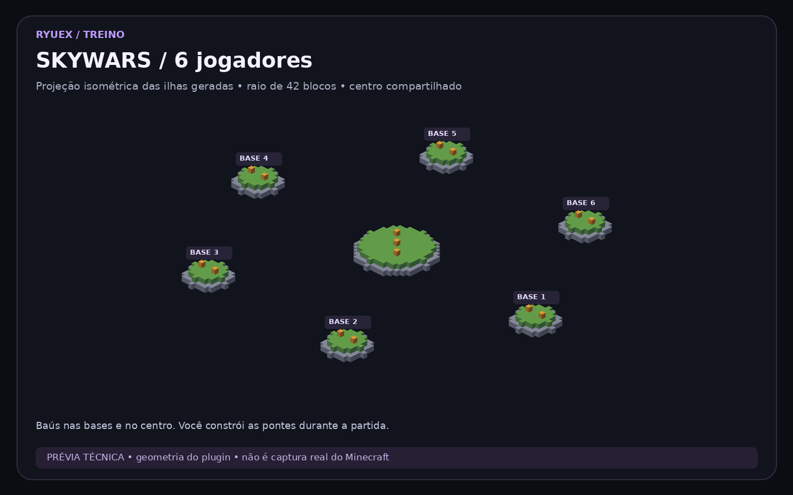

# Galeria do projeto

[← Início](../README.md) · [Instalar](GUIA.md)

**Estas imagens são prévias técnicas, não capturas do jogo.** Elas mostram a geometria atual dos mapas e a disposição dos slots implementados em `Treino.java`. Não usam uma arena inventada ou uma imagem de outro servidor para representar o projeto.

A projeção usa cores simplificadas e blocos esquemáticos; texturas, iluminação, itens, HUD e aparência final dependem do cliente Minecraft. A plataforma de espera acima das arenas não aparece nas vistas das partidas.

## Lobby

Plataforma de quartzo, iluminação na borda e bússola para abrir os modos.


## Menu

Disposição dos slots BedWars, BedFight, SkyWars e lista de salas. As siglas ilustram os ícones; dentro do Minecraft são itens do inventário.


## SkyWars com 6 jogadores

Seis bases, dois baús por base e baús no centro. As pontes são construídas durante a partida.



## BedWars com 4 jogadores

Quatro ilhas individuais com cama e bancada/loja, além do centro.


## BedFight 1x1

Duas bases para treinar ponte, combate e quebra de cama.


## Adicionar screenshots reais

Depois que o servidor estiver iniciado, entre com Minecraft Java 1.8.9 e use **F2** para capturar lobby, menu e cada arena. As imagens ficam na pasta `screenshots` da instância do seu launcher. Envie as capturas para `docs/images/` e identifique-as como screenshots reais nesta página.

Nenhuma captura real foi produzida ou validada nesta versão. Não há promessa de que a tipografia e as cores da prévia sejam a interface real do Minecraft.

Para regenerar estas projeções técnicas, com Python 3 e Pillow instalados:

```bash
python3 scripts/render-previews.py
```
