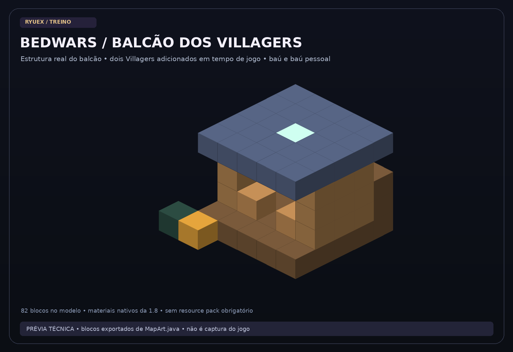
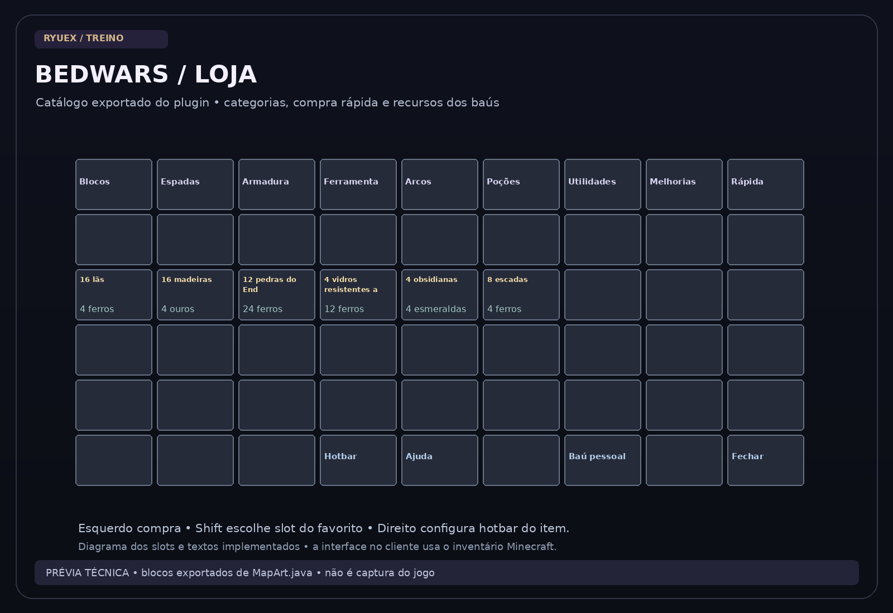
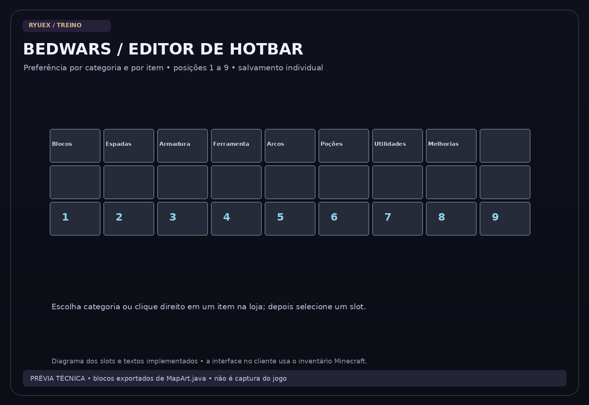

# Loja BedWars • 1.4.0

[← Início](../README.md) · [Galeria](GALERIA.md) · [Referências e diferenças](REFERENCIAS.md)

A loja agora tem **dois Villagers reais** no balcão lateral: **LOJA** e **MELHORIAS**. Ambos ficam parados, têm dano protegido e abrem a interface do plugin, sem a negociação vanilla. São Villagers padrão do Minecraft, não NPCs humanos com skin. O servidor usa NoAI da base 1.8.8 e mantém a posição ancorada; não precisa de Citizens ou outro plugin de NPC.

Abra pelo Villager, bancada ou `/treino loja`. A loja existe **somente em BedWars**. BedFight usa kit pronto e cama protegida; SkyWars usa baús.

## Interface

Categorias: Blocos, Espadas, Armaduras, Ferramentas, Arcos, Poções, Utilidades, Melhorias e Compra rápida. O catálogo é definido em [BedwarsItems.java](../src/main/java/br/ryuex/treino/BedwarsItems.java); preços são deste projeto e não equivalem a uma certificação dos preços atuais do Mush.

| Entrada | Ação |
| --- | --- |
| Clique esquerdo em um produto | Compra se houver recursos e espaço. |
| Shift + clique | Abre 27 posições para escolher onde o favorito ficará. |
| Botão direito no editor de favoritos | Limpa aquela posição. |
| Clique direito em um produto | Configura o slot de hotbar desse item. |
| Livro na parte inferior | Editor por categoria; escolha categoria e slot 1–9. |
| Baú do Fim na parte inferior | Abre seu armazenamento pessoal da partida. |
| `/importarcomprarapida NICK` | Copia a disposição de favoritos de um perfil já registrado neste servidor. |

Favoritos mantêm os espaços vazios e a ordem escolhida. Mover um favorito remove a posição anterior para não duplicá-lo. Importar não altera a configuração do outro jogador. O editor de hotbar permite regra por item e por categoria; uma regra específica do item tem prioridade. Se o slot escolhido estiver ocupado por outro item, a compra vai para outro espaço disponível.

## Recursos e compras

Compras comuns procuram recursos nesta ordem: **inventário → seu baú pessoal → baú do time**. Melhorias procuram **inventário → baú do time → seu baú pessoal → baús pessoais dos parceiros → inventários dos parceiros**. Na dupla, as melhorias são compartilhadas. A consulta soma unidades, sem contar duas vezes a mesma fonte, e verifica o total antes de retirar qualquer recurso. Uma compra recusada por saldo insuficiente não desconta parcialmente.

O baú comum fica na lateral da base e é físico. O baú pessoal é uma GUI exclusiva por jogador/sala, aberta pelo bloco de baú do Fim; os recursos não passam automaticamente de uma partida para outra. Cuidado: o baú físico é acessível na arena, inclusive por quem chegar à sua base.

## Catálogo e permanência

- Blocos: lã da cor do time, madeira, pedra do End, vidro resistente a explosões, obsidiana e escada.
- Combate: espadas de pedra/ferro/diamante, graveto de repulsão, arcos normal/Força I/Força I + Impacto I e flechas.
- Armaduras: calças e botas de malha, ferro e diamante; ficam com o jogador ao renascer. Não equipam o parceiro automaticamente.
- Ferramentas: picaretas, machados até diamante e tesoura. Mantêm o nível comprado após a morte nesta implementação.
- Poções: velocidade e salto.
- Utilidades: bola de fogo, estilingue, golem, TNT, pérola, maçã e água.
- Melhorias: Afiação I, Proteção I e Forja II, compartilhadas pelo time.

Ferramentas de nível igual/inferior e melhorias já adquiridas são recusadas. Explosões preservam cama e decoração original; é preciso quebrar a cama diretamente. Vidro e obsidiana resistem; pedra do End resiste à bola de fogo. O vidro protege o próprio bloco, sem simular escudo para os blocos atrás dele.

## Diferenças ainda existentes

Não há todas as utilidades, armadilhas e níveis de melhorias do Mush, missões, cosméticos, skins humanas de vendedores ou sincronização de perfis com outra rede. A loja não é uma cópia 100%. A disposição e os fluxos implementados acima foram inspirados nas funcionalidades públicas e estão documentados para teste.
